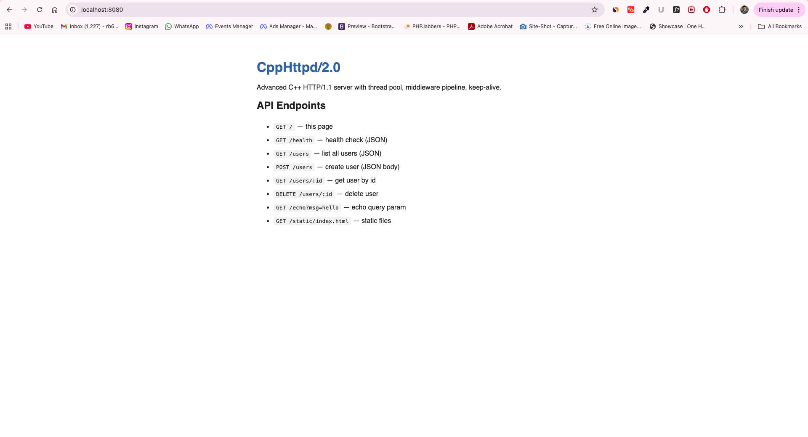

[](https://github.com/sandeepraj25/cpp-http-server/actions/workflows/ci.yml)


# CppHttpd: Multithreaded HTTP/1.1 Server in C++

An HTTP/1.1 server written from scratch in modern C++17, with no frameworks or
external libraries. It uses POSIX sockets, a fixed-size thread pool, an
Express-style middleware pipeline, a router with dynamic path parameters, and a
cached static file server.

**At a glance**

- **~64,000 requests/sec** at 100 concurrent connections, **0.23 ms** median latency ([benchmarks](bench/RESULTS.md))
- **Keep-Alive roughly doubles throughput** (34K → 64K requests/sec)
- **Per-IP sliding-window rate limiting**, security headers, path-traversal protection
- **53 unit checks + 24 end-to-end tests**, clean under **AddressSanitizer** and **ThreadSanitizer**
- CI on Linux and macOS with GitHub Actions



---

## Quick start

```bash
make            # build ./server
./server        # http://localhost:8080
```

```bash
curl http://localhost:8080/health
curl -X POST http://localhost:8080/users -d '{"name":"Alice","email":"alice@example.com"}'
curl http://localhost:8080/users/1
curl -X PUT  http://localhost:8080/users/1 -d '{"name":"Alicia"}'
curl -X DELETE http://localhost:8080/users/1
curl "http://localhost:8080/echo?msg=hello"
curl http://localhost:8080/static/index.html
```

Configuration through environment variables (no recompiling):

| Variable | Default | Meaning |
|---|---|---|
| `PORT` | `8080` | Port to listen on |
| `THREADS` | `8` | Worker threads in the pool |
| `RATE_LIMIT` | on | Set to `off` to disable rate limiting (used for benchmarks) |
| `RATE_LIMIT_MAX` | `200` | Requests allowed per IP per window |
| `RATE_LIMIT_WINDOW` | `60` | Window length in seconds |

---

## Features

**Core server**
- HTTP/1.1 request parsing: request line, headers, query string, `Content-Length` body
- Fixed-size thread pool (`std::thread`, `std::mutex`, `std::condition_variable`, `std::atomic`)
- Keep-Alive: up to 100 requests per connection, 5-second idle timeout
- Request pipelining: several requests sent back-to-back on one connection are all answered
- Graceful shutdown on `SIGINT`/`SIGTERM`; `SIGPIPE` ignored so a dropped client never kills the process

**Routing and middleware**
- Router with dynamic parameters (`/users/:id`) and wildcards (`/static/*`), with correct `404` vs `405`
- Middleware pipeline in the style of Express.js: each middleware can run code before and after the handler, or stop the chain

**Built-in middleware**
- Access logger (thread-safe)
- CORS headers
- Security headers: `Content-Security-Policy`, `X-Frame-Options`, `X-Content-Type-Options`, `Referrer-Policy`
- **Per-IP sliding-window rate limiter** returning `429` with a `Retry-After` header

**Static files**
- Serves files under `./static`, including nested folders
- MIME type detection from the file extension
- In-memory cache, invalidated automatically when a file changes on disk
- Path traversal blocked (`/static/../Makefile` returns `403`)

**REST API (demo, in-memory store)**

| Method | Path | Result |
|---|---|---|
| `GET` | `/health` | Health check |
| `GET` | `/users` | List users |
| `POST` | `/users` | Create a user → `201` |
| `GET` | `/users/:id` | Get one user |
| `PUT` | `/users/:id` | Update a user |
| `DELETE` | `/users/:id` | Delete a user → `204` |
| `GET` | `/echo?msg=hello` | Echo a query parameter |

---

## How a request flows

```
 client
   │  TCP connect
   ▼
 accept()  ── main thread only accepts, then hands the socket to the pool
   │
   ▼
 ThreadPool  ── one free worker takes the connection
   │
   ▼
 ConnectionHandler  ── loop: read one request → respond → repeat (Keep-Alive)
   │   reads bytes until "\r\n\r\n" + Content-Length bytes are in the buffer
   ▼
 HttpParser  ── raw text → HttpRequest (method, path, headers, query, body)
   │
   ▼
 Middleware pipeline   logger → CORS → rate limiter → security headers
   │                   (any middleware may stop here, e.g. 429)
   ▼
 Router  ── match path + method → handler (or static file server)
   │
   ▼
 HttpResponse.serialize() → send() until every byte is written
```

---

## Design decisions and trade-offs

**Thread pool instead of one thread per connection.** Creating a thread costs
memory (about 8 MB of stack by default) and time. A fixed pool caps resource use
no matter how many clients connect; extra connections wait in a queue.

**Thread-per-connection while a connection is open.** Simple to write and reason
about: each request is plain blocking code. The cost: a slow or idle Keep-Alive
client occupies a worker until its 5-second timeout. Under heavy load, this shows
up as high p99 latency (see [benchmarks](bench/RESULTS.md)). An `epoll`/`kqueue`
event loop would fix it and is the next step on the roadmap.

**Sliding window instead of fixed window for rate limiting.** A fixed window
resets at fixed times, so a client could send 200 requests at 0:59 and 200 more
at 1:01. The sliding log keeps each IP's recent timestamps in a `std::deque`,
drops expired ones from the front, and counts what is left: **O(1) amortized per
request, O(limit) memory per IP**. Idle IPs are swept periodically so the map
cannot grow forever.

**Rate limit by IP, not IP and port.** Each new TCP connection gets a new client
port. Keying by `ip:port` (the original version did this) let a client bypass the
limit just by reconnecting.

**TCP is a byte stream, not messages.** One `recv()` can return half a request or
two requests. The handler keeps unused bytes in a buffer, so partial reads and
pipelined requests both work.

**Never trust client input.** The parser validates `Content-Length`, rejects
bodies over 1 MB with `413`, and never throws on bad input. Handlers run inside a
`try`/`catch`, so one failing request returns `500` instead of crashing every
other connection.

---

## Bugs found and fixed while hardening the server

| Bug | How it was found | Fix |
|---|---|---|
| `GET /echo?msg=%zz` **crashed the whole server** (`std::stoi` threw in a worker thread → `std::terminate`) | Manual fuzzing with malformed requests | Non-throwing hex decoder; per-connection `try`/`catch` |
| `Content-Length: abc` **crashed the server** (`std::stoul`) | Same | Validated parser, `400`/`413` responses |
| Rate limiter could be bypassed by reconnecting | Code review | Key by client IP only |
| Rate limiter was a fixed window, not sliding | Code review | Sliding-log algorithm with `std::deque` |
| **Data race** in the logger: `std::localtime` returns a shared static buffer | **ThreadSanitizer** | `localtime_r` with a per-call buffer |
| Logging inside the signal handler (not async-signal-safe, can deadlock) | **ThreadSanitizer** | Handler only sets atomics and calls `shutdown()` |
| JSON injection: `/echo?msg=a","admin":"true` added fields to the response | Code review | `jsonEscape()` on all user-provided values |
| Pipelined requests after the first were silently dropped | Integration test | Leftover-bytes buffer in the connection handler |
| Ctrl+C never stopped the server on **macOS**: `shutdown()` does not wake a blocked `accept()` there | macOS CI job hung | `poll()` with a 250 ms timeout before `accept()`, re-checking the shutdown flag |

---

## Testing

```bash
make test        # unit tests (with ASan + UBSan) + end-to-end integration tests
make sanitize    # everything again under AddressSanitizer and ThreadSanitizer
make bench       # load test with wrk (see bench/RESULTS.md)
```

- **Unit tests** (`tests/unit_tests.cpp`): parser, URL decoding, JSON escaping,
  router matching and 404/405, sliding-window behaviour, per-IP isolation,
  rate limiter under 8 concurrent threads, thread pool, middleware order.
- **Integration tests** (`tests/integration_test.sh`): start the real server and
  check the REST API, static files, security headers, malformed requests,
  pipelining and Keep-Alive.
- **CI** runs all of the above on every push, on Linux and macOS.

---

## Project structure

```
cpp-http-server/
├── src/main.cpp                  # routes + config (REST API demo)
├── include/
│   ├── config.h                  # ServerConfig defaults
│   ├── http_server.h             # socket setup, accept loop, signals
│   ├── thread_pool.h             # fixed-size worker pool
│   ├── connection_handler.h      # per-connection read/respond loop, Keep-Alive
│   ├── http_parser.h             # request parsing and validation
│   ├── http_types.h              # HttpRequest, HttpResponse, jsonEscape
│   ├── router.h                  # path matching with :params and *
│   ├── middleware.h              # pipeline, CORS, security headers, rate limiter
│   ├── static_server.h           # static files, MIME types, cache
│   └── logger.h                  # thread-safe logger
├── tests/
│   ├── unit_tests.cpp
│   └── integration_test.sh
├── bench/
│   ├── run_benchmarks.sh
│   └── RESULTS.md
├── static/index.html
├── .github/workflows/ci.yml
└── Makefile
```

---

## Known limitations

- Blocking I/O with a thread per active connection, so tail latency grows under
  very high concurrency (see design decisions above).
- No TLS. In production it would sit behind a reverse proxy like Nginx or Cloudflare that terminates HTTPS.
- No chunked transfer encoding for request bodies; `Content-Length` is required.
- The JSON handling in the demo API is a minimal field extractor, not a full JSON parser.
- The user store is in memory and is lost on restart.

## Roadmap

1. `epoll` (Linux) / `kqueue` (macOS) event loop, benchmarked against the thread pool
2. Zero-copy static files with `sendfile()`
3. HTTPS with OpenSSL
4. Chunked transfer encoding
5. Fuzzing the parser with libFuzzer

---

## Author

**Sandeep Raj** · [GitHub](https://github.com/sandeepraj25) · [LinkedIn](https://linkedin.com/in/sandeepraj25)

Licensed under the Apache License 2.0.
